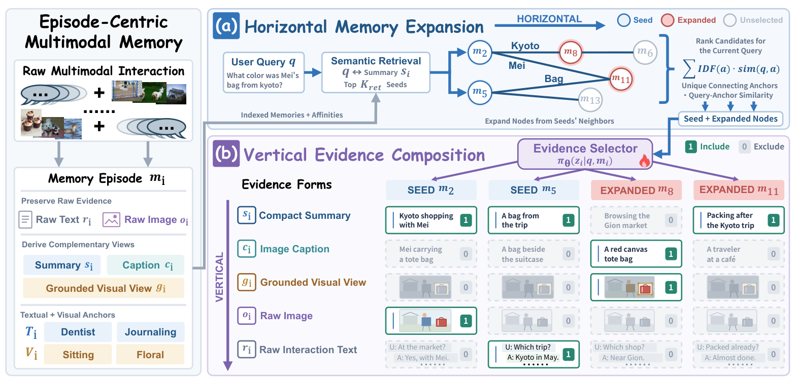

<p align="center">
  
</p>

<h1 align="center">HiVe-Mem</h1>
<h3 align="center">Interleaving Horizontal Memory Expansion and<br>Vertical Evidence Composition for Multimodal Agents</h3>

<p align="center">
  <strong>Broader recall. Sharper evidence.</strong><br>
  Retrieve connected memories and compose the evidence each query needs.
</p>

<p align="center">
  <a href="https://viktoraxelsen.github.io/HiVe-Mem/"></a>
  
  <a href="LICENSE"></a>
</p>

<p align="center">
  <a href="#overview">Overview</a> &middot;
  <a href="#installation">Installation</a> &middot;
  <a href="#configuration">Configuration</a> &middot;
  <a href="#data-preparation">Data</a> &middot;
  <a href="#training">Training</a> &middot;
  <a href="#evaluation">Evaluation</a> &middot;
  <a href="#citation">Citation</a>
</p>

<a id="overview"></a>
## Overview

**HiVe-Mem** is a multimodal memory framework for agents with long text-image interaction histories. It addresses two complementary questions: **which memories should be recalled, and what evidence should each memory contribute?**

- **Horizontal Memory Expansion** connects episodes through textual and visual anchors in a Cross-Episode Affinity Graph. Query-relevant neighbors complement directly retrieved memories.
- **Vertical Evidence Composition** uses a lightweight PPO-trained selector to choose a different evidence subset for each retrieved episode: compact summary, raw interaction text, image caption, raw image, and grounded visual view (GVV).

<p align="center">
  
</p>

<a id="installation"></a>
## Installation

Linux, Python 3.10+, and Bash:

```bash
git clone https://github.com/ViktorAxelsen/HiVe-Mem.git
cd HiVe-Mem
bash scripts/install.sh
source .venv/bin/activate
cp .env.example .env
```

<a id="configuration"></a>
## Configuration

Set model endpoints and API keys in [`.env`](.env.example). The launcher loads it automatically; chat endpoints must support the OpenAI-compatible multimodal API.

| Role | Environment settings | Example model |
| :--- | :--- | :--- |
| Answering | `HIVE_ANSWER_BASE_URL`, `HIVE_ANSWER_MODEL`, `ANSWER_API_KEY` | `Qwen/Qwen3-VL-4B-Instruct` |
| Memory / GVV extraction | `HIVE_EXECUTOR_BASE_URL`, `HIVE_EXECUTOR_MODEL`, `EXECUTOR_API_KEY` | `Qwen/Qwen3-VL-4B-Instruct` |
| Embedding | `HIVE_EMBEDDING_BASE_URL`, `HIVE_EMBEDDING_MODEL`, `HIVE_EMBEDDING_DIM`, `EMBEDDING_API_KEY` | `Qwen/Qwen3-VL-Embedding-2B`, dimension `2048` |
| LLM judge | `HIVE_JUDGE_BASE_URL`, `HIVE_JUDGE_MODEL`, `JUDGE_API_KEY` | `openai/gpt-4o-mini` |

Set API roots explicitly, including `/v1` where required. Query and memory embeddings must use the same model, dimension, and revision. Defaults are in [`configs/defaults.json`](configs/defaults.json) and [`configs/experiments.json`](configs/experiments.json).

Before PPO, prepare the answer-model processor below and set `HIVE_TOKENIZER=data/models/answer-processor` in `.env`:

```bash
python -c 'from transformers import AutoProcessor; AutoProcessor.from_pretrained("Qwen/Qwen3-VL-4B-Instruct").save_pretrained("data/models/answer-processor")'
```

<a id="data-preparation"></a>
## Data preparation

The supported benchmarks and raw-data layouts are:

| Benchmark | Upstream data | Expected contents under its resolved root |
| :--- | :--- | :--- |
| Mem-Gallery | [Ethan-Bei/Mem-Gallery](https://huggingface.co/datasets/Ethan-Bei/Mem-Gallery) | `dialog/`, `image/` |
| H2HMem | [varib/H2HMEM](https://huggingface.co/datasets/varib/H2HMEM) | `dyadic/`, `multi-party/` |
| WorldMemArena | [LCZZZZ/WorldMemArena](https://huggingface.co/datasets/LCZZZZ/WorldMemArena) | Lifelong subset: `project/`, `personal/`, images |

```bash
# Mem-Gallery example
bash scripts/run.sh prepare download memgallery
bash scripts/run.sh prepare chunks --benchmark memgallery
bash scripts/run.sh prepare queries --benchmark memgallery
```

Use `h2hmem` or `wma` for the other benchmarks. H2HMem requires chunk preparation for both `--variant dyadic` and `--variant multiparty`. Downloads go to `data/raw/`; set the roots in `.env` for existing datasets. Query preparation loads the encoder locally.

## Build the memory bank

Start the executor and embedding services, then build memories, the affinity graph, and grounded visual views:

```bash
bash scripts/run.sh build --benchmark memgallery --all-datasets
bash scripts/run.sh graph --degree-cap 4 outputs/memory/memgallery/datasets/*
bash scripts/run.sh gvv extract --dataset Mem-Gallery
```

For the other benchmarks, replace `memgallery` with `h2hmem` / `wma` and the GVV dataset name with `H2HMEM` / `WorldMemArena`. Use `build --local-embedding` to load the encoder locally.

<a id="training"></a>
## Training

Train the evidence selector after preparing data, vectors, memory graphs, and GVV artifacts:

```bash
bash scripts/run.sh train --benchmark memgallery
```

To run preparation, training, evaluation, and judging together:

```bash
bash scripts/ppo.sh all --benchmark memgallery --gpu 0
```

The combined workflow expects raw data, chunks, cached encoder weights, and model services. Use `--benchmark all` to process all three benchmarks. The selected checkpoint is `outputs/evidence_policy/<benchmark>/checkpoints/best.pt`.

<a id="evaluation"></a>
## Evaluation

Evaluate the learned selector or the full-evidence baseline, then compute LLM-Judge scores:

```bash
bash scripts/run.sh eval policy --benchmark memgallery --strategy ppo --split test \
  --checkpoint outputs/evidence_policy/memgallery/checkpoints/best.pt
bash scripts/run.sh eval policy --benchmark memgallery --strategy full-evidence --split test

bash scripts/run.sh judge --benchmark memgallery \
  --results outputs/evidence_policy/memgallery/eval/test_ppo/results.json \
  --out-dir outputs/judge/memgallery/ppo
```

For graph-only evaluation, including judging:

```bash
bash scripts/run.sh eval --benchmark Mem-Gallery
```

Policy results are saved under `outputs/evidence_policy/<benchmark>/eval/`; graph runs use `outputs/evaluation/`. Each command accepts `--help` for additional options.

## Repository

```text
src/               Memory episodes, construction, affinity graphs, retrieval
evidence_policy/   Evidence composition, PPO, training and policy evaluation
embedding/         Dataset preparation, embedding backends, query vector caches
gvv_extractor/     Grounded visual view discovery, cropping, artifact export
benchmarks/        Shared evaluation and three dataset-specific harnesses
configs/           Runtime defaults, experiment protocols, frozen source/split reference
scripts/           Installation, unified launcher, and combined PPO workflow
docs/              Static project website and assets
```

## Acknowledgments

We thank the teams behind [Mem-Gallery](https://github.com/YuanchenBei/Mem-Gallery), [WorldMemArena](https://github.com/UCSB-AI/WorldMemArena), [H2HMem](https://github.com/varib1/H2HMEM), and [Qwen](https://github.com/QwenLM) for their datasets, models, and supporting tools.

<a id="citation"></a>
## Citation

If you use HiVe-Mem in your research, please cite the paper (arXiv ID: TBD):

```bibtex
@article{hivemem2026,
  title = {{HiVe-Mem}: Interleaving Horizontal Memory Expansion and Vertical Evidence Composition for Multimodal Agents},
  author = {Zhang, Haozhen and Liu, Bohan and Bao, Jianzhu and Liu, Qingyuan and Yue, Haodong and Li, Xiao and Lim, Zi Pong and Wang, Wenya},
  journal = {arXiv preprint arXiv:TBD},
  year = {2026}
}
```

## License

The code is distributed under the [MIT License](LICENSE). Datasets, model weights, and other upstream resources retain their respective licenses and terms. In particular, the linked WorldMemArena dataset is labeled [CC BY-NC 4.0](https://huggingface.co/datasets/LCZZZZ/WorldMemArena).
